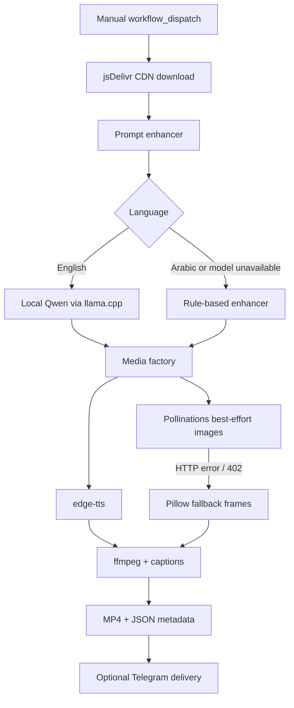

# RelayMind Core

  

Centralized engine for turning a topic into a vertical short video. Client repositories download the engine through jsDelivr and run it on their own GitHub Actions runners. The local English model runtime and weights are cached per client repository after first download; Arabic jobs skip that download and use the Arabic-native deterministic enhancer.

## Architecture

## Centralized CDN Engine

Client workflow template: [templates/client_workflow.yml](templates/client_workflow.yml). It downloads `runner.py` and the engine modules from `https://cdn.jsdelivr.net/gh/zopair/relaymind-core@main/`. Client execution is local to the client Actions runner. CDN delivery avoids cloning this repository in client workflows; it does not eliminate upstream/CDN network traffic.

## Zero-Cost / Open-Source Stack

- GitHub Actions, local llama.cpp inference and the Apache-2.0 Qwen2.5-1.5B-Instruct Q4_K_M model for English jobs.
- Arabic uses a deterministic Arabic-native enhancer to avoid the model's observed language mismatch.
- `edge-tts` for speech synthesis, relying on a public Edge speech service without a guaranteed free-tier SLA.
- Pollinations image endpoint is best-effort only. During validation it returned HTTP 402 on some scenes; RelayMind never pays or supplies a key and switches to Pillow fallback frames.
- ffmpeg, Pillow and Python open-source packages.
- Optional Telegram Bot API delivery.

**Important provider change (verified 2026-11-21):** GitHub Models was fully retired on July 30, 2026, including its inference API. RelayMind no longer relies on it. The English local-model path uses the MIT-licensed llama.cpp runtime and Apache-2.0 Qwen2.5-1.5B-Instruct Q4_K_M GGUF model. Runtime and model downloads are SHA-256 verified and cached by Actions. No hosted LLM API key is needed.

## Minute-Saving Protocol

- `workflow_dispatch` only; no idle cron.
- Concurrency lock; `timeout-minutes: 4` in the client workflow.
- pip and local-model caching; bounded retries and network timeouts.
- Four visual scenes and one ffmpeg render.
- No server, database, paid API or always-on worker.

Four minutes is a hard job ceiling, not a guarantee of successful 1080×1920 rendering for every topic. Hosted runner load, external service latency and narration length affect runtime.

## Setup

Copy `templates/client_workflow.yml` to a client repository as `.github/workflows/relaymind.yml`. Run it manually and enter a topic. Optionally configure repository secrets `TG_TOKEN` and `TG_CHAT_ID`.

## Environment

| Variable | Purpose |
|---|---|
| `TOPIC` | Required user idea |
| `LANG` | `auto`, `ar`, or `en` |
| `RELAYMIND_LLAMA_CLI` | Path to the verified local llama.cpp CLI binary |
| `RELAYMIND_MODEL_PATH` | Path to the verified Qwen GGUF model |
| `TG_TOKEN`, `TG_CHAT_ID` | Optional Telegram delivery |
| `WA_PHONE` | Reserved only; WhatsApp delivery is not implemented |

A phone number alone cannot send WhatsApp messages. It requires an authorized WhatsApp Business API integration and credentials. This engine does not claim to send WhatsApp messages.

## Outputs

`output/final_short.mp4`, `output/metadata.json`, four scene images and `output/voiceover.mp3`.

## Proof of Concept & Enterprise Customization Readiness

**Status:** 12 regression tests, offline FFmpeg rendering and live Arabic MP4 generation passed GitHub Actions. Arabic uses the deterministic enhancer and Salma neural voice. The English local Qwen path is configured but still requires a dedicated real-output quality check. Pollinations image relevance and free-tier availability are not guaranteed; the tested HTTP 402 path falls back without paid access.

**Changelog:** centralized CDN engine, multilingual prompt fallback, local Qwen English runtime, media fallbacks, resolver, Telegram delivery and manual workflow template.

## Intellectual Property & Authorship

Copyright © Aly Hussein Zopair (علي حسين زبير ALY HUSSEIN ZOPAIR). All rights reserved unless a separate license or written agreement states otherwise.
