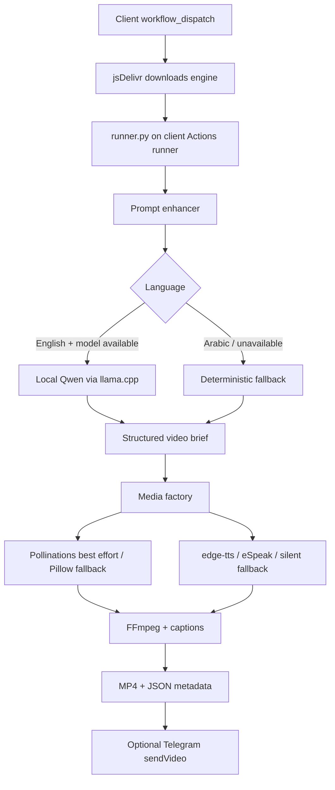

# RelayMind Core — Multilingual Vertical-Video Engine

[](https://www.python.org/)
[](.github/workflows/relaymind-validation.yml)
[](tests/)
[](LICENSE)
[](#proof-of-concept--enterprise-customization-readiness)

**RelayMind Core turns an English or Arabic topic into a vertical 1080×1920 short video using a centralized Python engine, local model inference for English prompt enhancement, deterministic Arabic fallback, media generation, narration, captions, and optional Telegram delivery.**

Client repositories can download the engine modules from jsDelivr and execute them on their own GitHub Actions runners. Video generation runs on the client runner; this repository does not host a permanent rendering server.

## 1. Project Overview & Problem Statement

Short-form video production combines topic development, narration, visual prompts, image assets, voice generation, subtitles, video encoding, and delivery. RelayMind packages those steps into a reusable pipeline with bounded execution and fallback behavior when optional providers fail.

Current capabilities include:
- Automatic Arabic/English topic detection, with explicit language override.
- Local Qwen2.5-1.5B-Instruct GGUF prompt enhancement for English when the verified llama.cpp runtime and model are provisioned.
- Deterministic Arabic-native and general rule-based fallback prompt generation.
- Four vertical scene images, using the best-effort Pollinations endpoint or Pillow-generated fallback frames.
- Narration through edge-tts, with local eSpeak or silent audio fallback where available.
- Subtitle generation and FFmpeg MP4 rendering.
- Optional Telegram video delivery when both Telegram secrets are configured.
- Metadata recording for prompt source, media sources, voice, elapsed time, and delivery result.

### Architecture



The diagram describes the current pipeline. WhatsApp delivery is not implemented.

## 2. Tech Stack & Versions

| Area | Repository-backed implementation |
|---|---|
| Runtime | Python 3.11 in GitHub Actions |
| Prompt enhancement | Local llama.cpp CLI with Qwen2.5-1.5B-Instruct Q4_K_M GGUF for English |
| Arabic / fallback prompts | Python deterministic rules |
| Speech | edge-tts; optional local eSpeak/eSpeak-NG fallback |
| Images | Pollinations best-effort endpoint; Pillow fallback |
| Video / audio | FFmpeg and ffprobe |
| Image processing | Pillow 10+ and below 12 |
| Runtime dependencies | edge-tts 7.x, Pillow 10.x/11.x |
| Development tests | pytest 8.x |
| Client distribution | jsDelivr CDN |
| Automation | GitHub Actions, actions/cache, upload-artifact |

The runtime dependency ranges are declared in [requirements.txt](requirements.txt), and development dependencies in [requirements-dev.txt](requirements-dev.txt). The llama.cpp runtime and Qwen model are downloaded separately by the workflow and checked against pinned SHA-256 digests.

## 3. Prerequisites & Dependencies

### For local execution

- Python 3.11.
- FFmpeg; ffprobe is used for media duration and verification when available.
- Python packages from `requirements.txt`.
- Optional eSpeak/eSpeak-NG for offline speech fallback.
- Optional verified llama.cpp CLI and Qwen GGUF model for local English prompt enhancement.

### For the client GitHub Actions workflow

- A GitHub repository with Actions enabled.
- Permission to run a manually dispatched workflow.
- Network access to jsDelivr, GitHub Releases, and the configured model download source.
- Optional Telegram bot credentials if video delivery is desired.

No paid API key or permanent server is required by the default architecture. External free endpoints can change availability or impose limits; fallback behavior does not guarantee equivalent image or voice quality.

## 4. Installation & Local Setup

### Run locally

Clone the repository:

```bash
git clone https://github.com/zopair/relaymind-core.git
cd relaymind-core
python -m venv .venv
source .venv/bin/activate
python -m pip install --upgrade pip
python -m pip install -r requirements.txt -r requirements-dev.txt
```

Install FFmpeg using your operating system's package manager.

Run the test suite:

```bash
pytest -q
```

Generate a video from a topic:

```bash
TOPIC="Arabic coffee from bean to cup" LANG=en python runner.py
```

The pipeline writes outputs under `output/`. For English local-model inference, set the CLI and model paths as described below; without them, the prompt enhancer uses its rule-based fallback.

### Use the centralized engine from another repository

Copy [templates/client_workflow.yml](templates/client_workflow.yml) into a client repository as:

`.github/workflows/relaymind.yml`

Run it manually from the repository's Actions tab, enter a topic, and select `auto`, `ar`, or `en`. The workflow downloads the engine modules from the jsDelivr URL pinned to the `main` branch, installs dependencies, and runs the pipeline on the client repository's Actions runner.

The template has a four-minute job timeout. This is a hard ceiling, not a guarantee that every topic will render successfully within that time.

## 5. Environment Variables

| Variable | Required | Purpose |
|---|---:|---|
| `TOPIC` | Yes | Input idea; empty values are rejected |
| `LANG` | No | `auto`, `ar`, or `en`; defaults to automatic detection |
| `RELAYMIND_LLAMA_CLI` | No | Path to the verified local llama.cpp CLI binary |
| `RELAYMIND_MODEL_PATH` | No | Path to the verified Qwen GGUF model |
| `TG_TOKEN` | No | Telegram bot token for optional video delivery |
| `TG_CHAT_ID` | No | Telegram destination chat ID; used with `TG_TOKEN` |
| `GITHUB_TOKEN` | No | Optional token for authenticated GitHub repository search in the resolver |
| `WA_PHONE` | Reserved | Not used to send WhatsApp messages; WhatsApp integration is not implemented |

Keep Telegram credentials in repository secrets or a local untracked environment file. Never commit tokens to source control. A phone number alone cannot send WhatsApp messages; this engine does not claim to provide WhatsApp delivery.

## 6. Usage Guide & Core Features

### Prompt enhancement

The engine detects Arabic script or English unless the caller explicitly sets `LANG`. English can use local Qwen inference when the model runtime is available. Arabic uses the deterministic Arabic-native enhancer to avoid relying on a model path that may produce language-mismatched output.

If local inference is unavailable or invalid, the pipeline falls back to deterministic prompt generation rather than requiring a hosted LLM API.

### Media generation

The media factory:
1. Generates four scene prompts and attempts image retrieval from Pollinations.
2. Uses Pillow-generated vertical fallback frames if image retrieval fails.
3. Generates narration with edge-tts.
4. Falls back to local eSpeak when available, then silent audio if voice services are unavailable and FFmpeg is present.
5. Creates SRT captions and renders a 1080×1920 MP4 with FFmpeg.

Fallback output is identified in the metadata; it should not be mistaken for the same editorial or visual quality as successful provider output.

### Outputs

The pipeline writes these files under `output/`:

- `final_short.mp4` — rendered vertical video.
- `metadata.json` — prompt and media metadata, including voice, image sources, elapsed time, and Telegram delivery result.
- `brief.json` — structured prompt brief.
- `scene_01.jpg` through `scene_04.jpg` — scene images.
- `voiceover.mp3` — generated or fallback audio.
- `captions.srt` and `scenes.txt` — render inputs.

### Optional Telegram delivery

When both `TG_TOKEN` and `TG_CHAT_ID` are set, the runner attempts to send the rendered MP4 using the Telegram Bot API. Delivery failures are reported and do not claim success. WhatsApp is not implemented.

### Resolver

The resolver performs bounded endpoint checks and can search GitHub metadata for open-source alternatives. It reports repository metadata only; it does not download or execute discovered code.

## 7. Live Demo & Screenshots

RelayMind Core is a reusable engine and GitHub Actions workflow template, not a hosted web application. No always-on rendering service or public interactive demo is deployed from this repository.

The validation workflow uploads its output directory as a short-lived Actions artifact. Client workflows also upload their generated output. Open the **Actions** tab, select a completed run, and download the corresponding artifact to inspect the MP4 and metadata.

## 8. Testing & Verification

Run all regression tests locally:

```bash
pytest -q
```

The current test suite contains 13 tests covering:
- Arabic/English language detection.
- Rule-based prompt structure and scene count.
- Empty-topic rejection and fallback behavior.
- Caption timestamp generation.
- FFmpeg filter construction.
- Pillow fallback image dimensions and format.
- Offline FFmpeg rendering and output resolution.
- Invalid endpoint handling.
- Local Qwen invocation without a remote inference API.
- Rejection of language-mismatched model output.
- Markdown-fenced JSON parsing.

The GitHub Actions validation workflow uses Python 3.11, installs FFmpeg, provisions the local model/runtime with SHA-256 verification, compiles modules, runs pytest, validates local English prompt generation, and attempts a live Arabic end-to-end sample. Workflow success is evidence for that run's checks, not a guarantee that external providers will remain available.

## Proof of Concept & Enterprise Customization Readiness

**Status: Functional PoC with local prompt inference, deterministic fallback paths, media rendering, and optional Telegram delivery. Not a hosted SaaS product.**

| Area | Current state |
|---|---|
| Centralized engine distribution | Implemented through jsDelivr |
| English prompt enhancement | Local Qwen path, with rule fallback |
| Arabic prompt enhancement | Deterministic Arabic-native path |
| Video rendering | FFmpeg pipeline, 1080×1920 output |
| Image generation | Best-effort Pollinations with Pillow fallback |
| Narration | edge-tts, optional eSpeak, or silent fallback |
| Telegram delivery | Optional Bot API integration |
| WhatsApp delivery | Not implemented |
| Permanent server / database | Not required |
| External endpoint SLA | Not guaranteed |

### Operational limits

- The client workflow's four-minute timeout is a hard cap; hosted runner load and external latency can cause a run to fail.
- Pollinations can return errors, including HTTP 402; the engine does not pay or supply a key and uses local Pillow fallback frames.
- edge-tts relies on a public speech service and has no guaranteed free-tier SLA.
- The model runtime and GGUF model are downloaded on English model-enabled runs and cached per client repository; first-run setup consumes network time and runner storage.
- The CDN template downloads the current `main` branch. For reproducible client deployments, pin the download URLs to a reviewed commit SHA before adopting the workflow for a critical pipeline.

### Change log

- Centralized CDN engine and reusable client workflow template.
- Multilingual prompt enhancement with deterministic Arabic fallback.
- Local Qwen English inference and checksum-verified runtime/model provisioning.
- Media generation with image, narration, and video fallbacks.
- Optional Telegram delivery and regression validation.

## Intellectual Property & Authorship

Copyright © 2026 **Aly Hussein Zopair (علي حسين زبير ALY HUSSEIN ZOPAIR)**.

The original RelayMind Core code and documentation are released under the MIT License; see [LICENSE](LICENSE). Third-party models, runtimes, libraries, APIs, and media services retain their own licenses and terms. In particular, the Qwen model and llama.cpp runtime are distributed under their respective upstream licenses.
