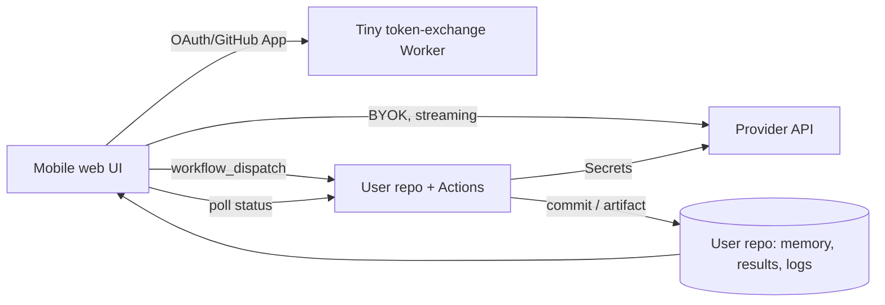

# InstaPro — Claude Review

- **Provider/model:** Anthropic Claude (Sonnet 5.5)
- **Review date:** 2026-11-21
- **Evidence links:** none verified in this round (see Assumptions and unknowns)
- **Executive verdict:** **Revise**
- **Confidence:** medium
- **Key assumptions:** each user has their own GitHub account, repo and provider API keys; no company-funded compute.

> Access note: I could read only `MASTER_REVIEW.md`. No other reviewer reports were available to me, so Round 2 is pending. I have not read or reacted to any other report.

## 1. Executive verdict

The premise (BYOC, GitHub-native, zero company compute) is viable. The part that does not survive is routing the fast chat through GitHub Actions: runner start-up latency makes it unsuitable for streaming. Split the system into two paths.

## 2. Recommended architecture

- **Fast path:** browser to provider directly with the user's key, or through a stateless pass-through Worker. The key is never in public files or shipped browser code.
- **Async path:** `workflow_dispatch` on the user's repo; Action reads keys from GitHub Secrets; output goes to a commit or artifact; UI polls run status.
- **Memory:** Markdown/JSON files in a private user repo.

## 3. Critical risks (ranked)

1. **Actions is not real-time.** Queue and runner start-up add latency. Resolution: chat never touches Actions.
2. **Secret exposure.** Keys in browser code or public repos leak. Resolution: GitHub Secrets for Actions; user-held key (or Worker pass-through) for chat.
3. **Actions quotas and cost.** Minutes and concurrency depend on the user's plan, and private repos consume quota. Resolution: Resource Governor (section 7). Exact current limits: unverified here.
4. **GitHub terms.** Using Actions as a persistent server or for abusive compute can violate the terms. Resolution: short, bounded jobs only; check the current Actions terms before launch.
5. **Provider terms.** Scraping private provider interfaces or sharing credentials is out. Resolution: official APIs only, one key per user.
6. **OAuth secret handling.** The OAuth code exchange needs a client secret, so a pure-static app cannot do it safely. Resolution: one small stateless Worker.

## 4. GitHub-native capability matrix

| Capability | Use | Limits and caveats |
|---|---|---|
| Actions + `workflow_dispatch` | async agent runs | queue latency; minutes quota per plan; job timeouts (verify current values) |
| Secrets | provider keys for Actions | not readable by the browser; not available to forks' PRs |
| Repo contents | memory, task results, logs | commit rate and repo size; keep files small |
| Artifacts | larger outputs | retention is limited; storage counts against quota |
| Pages | static UI hosting | static only; no server-side secrets |
| Codespaces | not needed for MVP | metered, not free beyond allowance |

Numbers are intentionally omitted because I did not verify them against docs.github.com.

## 5. Open-source components

**None verified in this round.** I am not listing repositories or licenses I could not check. Required before use: URL, exact license file, last-commit date, open-issue health. This is an open item for the coordinator or a reviewer with browsing access.

## 6. MVP roadmap

- **Phase 1:** GitHub sign-in + BYOK chat with one provider (streaming).
- **Phase 2:** "Run task" button: dispatch, status, logs.
- **Phase 3:** Memory in repo files + Resource Governor.
- **Later:** more providers, browser automation, approval flows, enterprise features.

## 7. Resource Governor (minimum)

- **Decision:** a `limits.json` in the user repo, enforced by the first step of every workflow.
- **Implementation:** fields for max runs/day, `timeout-minutes`, max agent steps, max tokens per task. The first step reads the file and fails the run if exceeded. Add `concurrency: group` to prevent parallel runs, and a UI kill button calling the cancel-run API.
- **Validation:** set max steps to 3, run a task that needs 10, expect the run to stop at step 3 with a clear log line.
- **Fallback:** if counting runs/day in-repo is unreliable, count via the Actions API at job start.

## 8. Auth comparison

- **GitHub App (recommended):** per-repo permissions (contents, actions), short-lived installation tokens.
- **OAuth App:** simpler, but scopes are broad (`repo` covers all repos).
- **Fine-grained PAT:** acceptable as an advanced fallback; manual paste, long-lived, higher leak risk.

Never place tokens or provider keys in browser source or public files.

## 9. Provider adapters

One interface: `stream(messages, options) -> token stream`. Official APIs only for Claude, Gemini, Grok and Perplexity, each with the user's key. Open-source models via Ollama (local) or any OpenAI-compatible endpoint. Current model names, prices and limits: unverified here; check each provider's docs.

## 10. Decisions needed before implementation

1. GitHub App or OAuth App?
2. No Worker at all, or one Worker for token exchange only?
3. Private or public user repos (affects quota and privacy)?

## 11. Assumptions and unknowns

- **Verified from the brief:** the requirements and constraints stated in `MASTER_REVIEW.md`.
- **Inference (not verified):** Actions latency behaviour; OAuth needing a server-side secret exchange; GitHub App token model.
- **Unverified facts:** current Actions limits and terms, provider pricing/API changes, any reusable repositories and their licenses.

## Round 2 — Cross-Review

Pending. No other reports were provided to me. Coordinator: please share the other reports and I will add agreements, disagreements, omissions and whether my verdict changes.

## Build now / Defer / First task

- **Build now:** Phase 1 + Phase 2.
- **Defer:** browser automation, additional providers, approvals, enterprise features.
- **First executable task:** a workflow triggered by `workflow_dispatch` with a `prompt` input that calls the Claude API using a key from GitHub Secrets and writes the reply to `results/<run_id>.md`. **Validation:** dispatch with "say hello" and confirm the file appears in the repo.
