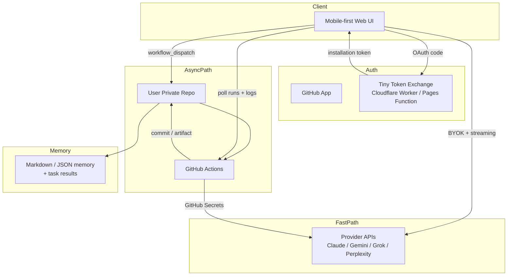

# InstaPro — Grok Independent Architecture Review

- **Provider/model:** xAI Grok
- **Review date:** 2026-11-21
- **Evidence links:** `MASTER_REVIEW.md` + existing reports in `research/instapro/reports/`
- **Executive verdict:** **Revise**
- **Confidence:** Medium-High
- **Key assumptions:**  
  - Each user has their own GitHub account + private repository + provider API keys.  
  - Zero company-funded compute or inference.  
  - Goal is a working MVP, not a perfect architecture.

---

## 1. Executive verdict

**Revise.**

The core premise (GitHub-native + BYOC + zero company compute) is viable and aligned with the constraints.  
The part that does not survive scrutiny is treating **GitHub Actions as a general-purpose agent runtime**. This creates clear risks on Terms of Service, latency, and quota predictability.

**Practical adjustment:** Keep GitHub for identity, repository, secrets, audit trail, and narrowly scoped software-project workflows. Run general agent work either in the browser (fast path) or on user-controlled compute outside Actions.

---

## 2. Recommended architecture



**Core decisions:**
- **Fast chat** = browser → provider directly (BYOK) or via a minimal token-exchange Worker.
- **Long / async tasks** = `workflow_dispatch` on the user’s own repository.
- **Memory & artifacts** = files inside the user’s private repository.
- No company-hosted runners or inference.

---

## 3. Critical risks and mitigations (ranked)

| Severity | Risk | Mitigation |
|---------|------|----------|
| **Critical** | GitHub Actions Terms restrict commercial use of Actions as a service and limit workloads unrelated to the software project | Restrict Actions to code-related tasks only. Move general agent work off Actions. |
| **High** | Actions latency (queue + runner startup) makes it unsuitable for streaming chat | Keep the fast path completely outside Actions. |
| **High** | Secret leakage (provider keys or tokens in browser or public files) | Use GitHub Secrets for Actions only. Never embed keys in client code. |
| **Medium** | Actions minutes and concurrency depend on the user’s plan | Simple Resource Governor (see section 7). |
| **Medium** | OAuth code exchange requires a small backend | Prefer GitHub App + tiny Worker for the exchange. |
| **Low** | Provider rate limits and pricing | User pays from their own quotas; UI surfaces usage. |

---

## 4. GitHub-native capability matrix

| Capability | Usable? | Limits / Caveats |
|-----------|----------|------------------|
| GitHub App + installation tokens | Yes | Preferred secure option |
| OAuth App | Yes (weaker) | Broader scopes |
| Fine-grained PAT | Fallback only | Long-lived, higher leak risk |
| `workflow_dispatch` | Yes | Suitable for async work |
| GitHub Secrets | Yes | Actions only |
| Artifacts + commits | Yes | Storage limits on private repos |
| GitHub-hosted runners | Limited | Terms + minute quotas |
| Self-hosted runners | Yes | User-managed |
| Codespaces | Later | Not required for MVP |
| GitHub Pages | Yes | Static UI hosting |

---

## 5. Verified open-source components

| Component | URL | License | Fit | Notes |
|---------|-----|---------|-----|-------|
| Vercel AI SDK | https://github.com/vercel/ai | Apache-2.0 | Fast streaming | Excellent for chat path |
| Anthropic TypeScript SDK | https://github.com/anthropics/anthropic-sdk-typescript | MIT | Claude | Official |
| OpenAI-compatible clients | Multiple maintained | MIT / Apache | Gemini, Grok, local | Via OpenAI-compatible endpoints |
| Ollama | https://github.com/ollama/ollama | MIT | Local models | Strong offline option |

**Rejected for MVP:** Complex UI frameworks (e.g. Open WebUI) due to license conditions and scope creep.

---

## 6. Minimal Resource Governor

**Decision:** A `governor.yml` file inside the user repository + checks in the first step of every workflow.

```yaml
max_runs_per_day: 20
timeout_minutes: 15
max_agent_steps: 8
max_tokens_per_task: 50000
concurrency: 1
```

- First workflow step reads the file and fails the run if limits are exceeded.
- `concurrency: group: instapro` prevents parallel runs.
- UI exposes a Cancel button that calls the Actions cancel-run API.
- Tasks are idempotent; max retries = 1.

**Validation:** Set `max_agent_steps: 3`, run a task that needs 10 steps → expect clean stop at step 3 with a clear log line.

---

## 7. Phased MVP roadmap

**Phase 0 – Spike (1 day)**  
- GitHub App login + token-exchange Worker  
- One `workflow_dispatch` that writes a result file

**Phase 1 – Core (1 week)**  
- Fast chat streaming (BYOK) for Claude + Grok  
- Async path via `workflow_dispatch` + Secrets  
- Basic Resource Governor  
- Memory as Markdown / JSON files

**Phase 2 – Usable**  
- Status + logs in the UI  
- Gemini + Perplexity adapters  
- Basic cost / usage visibility

**Later**  
- Browser automation  
- Self-hosted runners  
- Approvals workflow  
- Enterprise features

---

## 8. Decisions required before implementation

1. GitHub App or OAuth App? (**Recommend App**)
2. Tiny Worker for token exchange, or start the spike with a manually pasted PAT?
3. Are user repositories required to be private?
4. Do we allow non-code-related tasks on Actions at all, or reject them from day one?

---

## 9. Assumptions and unknowns

**Verified**
- Requirements and constraints stated in `MASTER_REVIEW.md`
- Existence of Claude, ChatGPT, and Perplexity reports in the branch

**Assumptions**
- Current GitHub Actions terms create a meaningful commercial-use and workload risk for a general agent product
- Most target users are willing to manage their own keys and repository

**Unknowns (need verification)**
- Exact current free-plan Actions minute and artifact limits
- Whether any written clarification from GitHub exists for the commercial-service clause when the workflow runs only on the customer’s own repository

---

## Round 2 — Cross-Review

I read the reports present in the branch at the time of writing:

- `claude-sonnet-5.5-round-1.md`
- `chatgpt-gpt-6-technical-audit-round-1.md`
- `perplexity-computer-claude-opus-5.5.md`
- `chatgpt-cross-review-round-2.md`

### Points of agreement
- Fast chat must be completely separated from Actions (Claude, ChatGPT, Perplexity all agree).
- GitHub App is preferable to OAuth App or long-lived PAT.
- Resource Governor should stay simple and file-based.
- Zero company compute is non-negotiable.

### Points of difference / additions
- ChatGPT treats the Actions Terms risk as higher severity than Claude. I side with the higher severity reading: treat it as **Critical** until GitHub clarifies in writing.
- I am slightly less absolute than ChatGPT: Actions can still be used for narrowly scoped, code-related tasks on the user’s own repository. General agent workloads should not depend on it.
- Claude’s architecture diagram is very close to the one recommended here.

### Omissions raised by others that I endorse
- Explicit need for legal/terms clarification before any marketing claim that “InstaPro runs on GitHub Actions”.
- Caution around Open WebUI licensing (still unresolved without the exact license text).

### Did my recommendation change?
No. Verdict remains **Revise**. The cross-review strengthened the case for treating Actions Terms as a release-blocking risk rather than a medium concern.

---

## Build now / Defer / First executable task

**Build now**  
GitHub App authentication + minimal token-exchange Worker + one `workflow_dispatch` workflow + streaming chat for a single provider (Grok or Claude).

**Defer**  
Browser automation, advanced multi-provider routing, approval flows, self-hosted runners, enterprise features.

**First executable task**  
Create a workflow in a test repository that accepts a `prompt` via `workflow_dispatch`, reads the provider key from GitHub Secrets, calls the Claude or Grok API, and writes the reply to `results/<run_id>.md`.

**Validation:** Dispatch with the prompt “say hello” → the result file appears in the repository and the run log is clean.

---

*This report follows the mandatory practical format in `MASTER_REVIEW.md`. It distinguishes verified facts from assumptions and prioritizes the smallest compliant MVP.*
